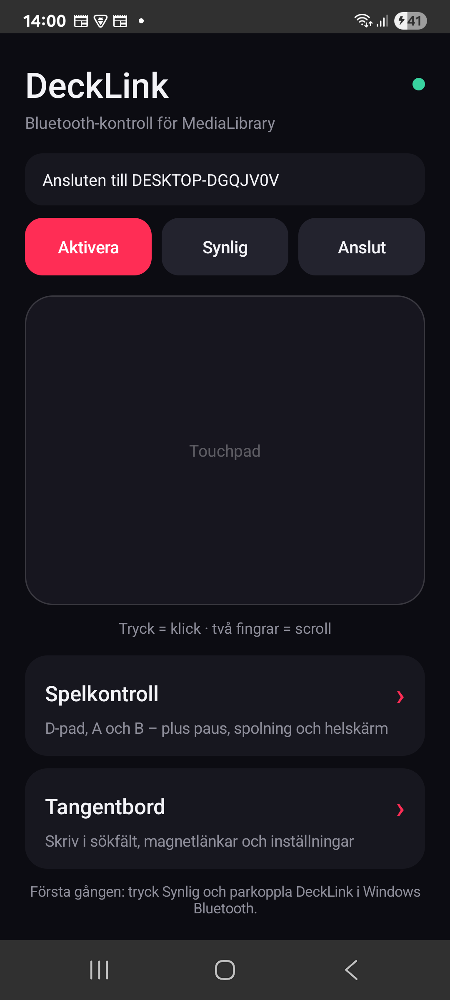
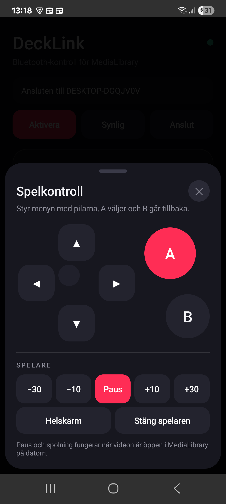
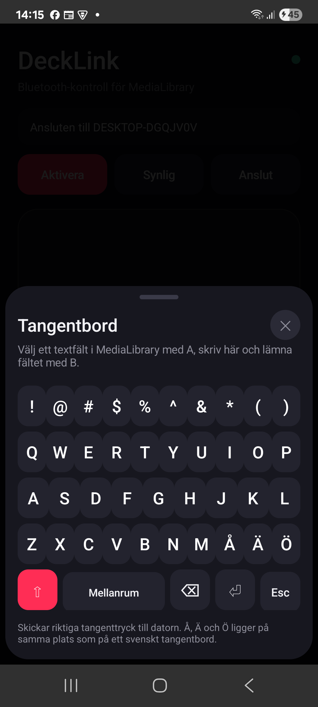

# DeckLink

Telefonen som trådlös handkontroll för **Media Library** på datorn: styrplatta
med klick och scroll, ett spelkontrolläge med D-pad och A/B, och ett
tangentbord för att skriva i sökfält och inställningar.

Appen använder **Bluetooth HID** och registrerar sig som ett vanligt trådlöst
tangentbord + mus. Därför behövs inget program på datorn – Windows ser DeckLink
som vilket tangentbord som helst. Den är byggd för Media Librarys gränssnitt och
spelare, men eftersom den skickar riktiga tangenter och musklick fungerar den
också i andra program.



## Skärmbilder

| Startskärmen | Spelkontroll | Tangentbord |
| --- | --- | --- |
|  |  |  |

---

## Innehåll

1. [Funktioner](#funktioner)
2. [Krav](#krav)
3. [Installera](#installera)
4. [Parkoppla med datorn](#parkoppla-med-datorn)
5. [Startskärmen](#startskärmen)
6. [Touchpad](#touchpad)
7. [Spelkontroll](#spelkontroll)
8. [Tangentbord](#tangentbord)
9. [Så används den med Media Library](#så-används-den-med-media-library)
10. [Anslutning och återanslutning](#anslutning-och-återanslutning)
11. [Felsökning](#felsökning)
12. [Bygga appen](#bygga-appen)
13. [Projektstruktur](#projektstruktur)

---

## Funktioner

- **Bluetooth HID** – telefonen registreras som trådlöst tangentbord + mus.
  Inget program, inget nätverk och ingen server behövs på datorn.
- **Touchpad** – ett finger flyttar pekaren, ett tryck vänsterklickar, två
  fingrar scrollar.
- **Spelkontroll** – D-pad som skickar piltangenter, **A** = Enter, **B** = Esc,
  plus en spelarpanel med spolning, paus och helskärm. Knapparna repeterar när
  de hålls nere.
- **Tangentbord** – qwerty med å/ä/ö, skift, mellanslag, backspace, Enter och
  Esc. Skickar riktiga tangenttryck till datorn.
- **Automatisk återanslutning** – tappas länken försöker appen koppla upp igen
  själv, och **Aktivera** återansluter om den redan är igång.

---

## Krav

- Android 9 (API 28) eller senare med Bluetooth.
- En dator med Bluetooth som kan parkopplas (Windows 10/11).
- Ingen extra programvara på datorn.

---

## Installera

### Färdig APK

```powershell
adb install -r android\app\build\outputs\apk\debug\app-debug.apk
```

Installera om du redan har en äldre DeckLink med annan signeringsnyckel:
avinstallera den först.

### Från källkoden

```powershell
cd DeckLink
.\build.ps1
adb install -r android\app\build\outputs\apk\debug\app-debug.apk
```

`build.ps1` pekar ut JDK 21 (`~/.jdks/jbr-21.0.11`) innan Gradle startar.
Projektet använder Gradle 8.9 och AGP 8.7.3 som kräver Java 17–21; Android
Studio 2026 buntar Java 25, så `gradle.properties` anger JDK 21 via
`org.gradle.java.home`. Öppnar du projektet i Android Studio: sätt
**Settings → Build, Execution, Deployment → Build Tools → Gradle → Gradle JDK**
till samma JDK 21 om synken klagar.

Paketnamnet är `com.example.decklink`.

---

## Parkoppla med datorn

1. Öppna appen och ge Bluetooth-behörighet när den frågar.
2. Tryck **Aktivera** (registrerar tangentbordet) och sedan **Synlig**.
3. På datorn: **Inställningar → Bluetooth → Lägg till enhet → DeckLink**.
4. Efter parkopplingen ansluter appen automatiskt. Annars: tryck **Anslut**.

Statusraden visar vad som händer: *Ansluten till …*, *Frånkopplad – ansluter
igen…* eller *Ingen parkopplad dator – gör DeckLink synlig först*. Den gröna
pricken uppe till höger lyser när länken är uppe.

---

## Startskärmen

| Knapp | Vad den gör |
| --- | --- |
| **Aktivera** | Registrerar HID-tangentbordet och ansluter till datorn. Fungerar också som återanslut om appen redan är igång. |
| **Synlig** | Gör telefonen synlig i 3 minuter så att Windows kan parkoppla den. |
| **Anslut** | Ansluter till en redan parkopplad dator. |
| **Spelkontroll** | Öppnar spelkontrollpanelen. |
| **Tangentbord** | Öppnar tangentbordet. |

---

## Touchpad

Det stora fältet i mitten är en styrplatta:

- **Ett finger** flyttar pekaren.
- **Ett tryck** = vänsterklick.
- **Två fingrar** scrollar.

Rörelsen skickas som relativa musrörelser, så pekaren rör sig lika mjukt som
med en vanlig mus.

---

## Spelkontroll

Panelen öppnas med **Spelkontroll** och innehåller:

| Knapp | Skickar | I Media Library |
| --- | --- | --- |
| ▲ ▼ ◀ ▶ | Piltangenter | Flyttar fokusringen mellan kort, avsnitt och knappar. I spelaren: ◀/▶ hoppar 10 sekunder. |
| **A** | Enter | Väljer markerat kort/knapp. I spelaren: pausar/spelar. |
| **B** | Esc | Går tillbaka ett steg, stänger spelaren. |
| −30 s | `J` | Hoppar 30 sekunder bakåt. |
| −10 s | `←` | Hoppar 10 sekunder bakåt. |
| Paus | `K` | Pausar/spelar. |
| +10 s | `→` | Hoppar 10 sekunder framåt. |
| +30 s | `L` | Hoppar 30 sekunder framåt. |
| Helskärm | `F` | Växlar fullskärm i spelaren. |
| Stäng spelare | `Esc` | Lämnar fullskärm eller stänger spelaren. |

Håller du en knapp nere repeteras den, vilket gör det snabbt att bläddra genom
långa listor.

---

## Tangentbord

Tangentbordet skickar riktiga tangenttryck till datorn – det som är markerat på
datorn får texten.

- Layout: `qwerty` med **å**, **ä**, **ö** på samma platser som på ett fysiskt
  svenskt tangentbord.
- **Skift** för stora bokstäver och symboler, **Mellanslag**, **Backspace**,
  **Enter** och **Esc**.
- Använd det till Media Librarys sökfält, magnetlänkar i Nedladdningar och
  textfält i Inställningar.

Öppna **Tangentbord**, tryck på skärmens tangenter och texten hamnar i det fält
som är markerat på datorn. Stäng rutan med **✕** när du är klar.

---

## Så används den med Media Library

DeckLink är designad för Media Library och knapparna motsvarar exakt appens
kontroller:

- **Navigera**: piltangenter/D-pad flyttar fokusringen, **A** väljer, **B** går
  tillbaka. Media Library visar tydligt vilken ruta som är markerad, så du kan
  styra hela appen från soffan utan mus.
- **Spelaren**: `K` pausar, `←`/`→` hoppar 10 sekunder, `J`/`L` hoppar 30
  sekunder, `F` växlar fullskärm och `Esc` stänger. Media Librarys spelare
  gömmer dessutom kontrollrad och muspekare automatiskt i fullskärm.
- **Sökfältet**: använd tangentbordet i DeckLink i stället för telefonens
  skärmtangentbord – texten går direkt till datorns aktiva fält.

Samma knappar fungerar i Windows i största allmänhet, eftersom telefonen
presenterar sig som ett vanligt tangentbord och en mus.

---

## Anslutning och återanslutning

- Appen ansluter automatiskt när den startas och när HID-registreringen blir
  klar.
- Om datorn sover, är utom räckhåll eller länken bryts försöker appen koppla upp
  igen några gånger med stigande väntetid.
- **Aktivera** återansluter även när appen redan är igång men saknar länk.
- Efter en ominstallation av appen kan en gammal registrering ligga kvar i
  telefonens Bluetooth-stack; appen avregistrerar då den gamla och registrerar om
  automatiskt.

---

## Felsökning

| Symptom | Åtgärd |
| --- | --- |
| Statusraden står kvar på *Startar…* | Ge Bluetooth-behörighet i Android-inställningarna och tryck **Aktivera**. |
| *Ingen parkopplad dator* | Tryck **Synlig** och parkoppla DeckLink i Windows Bluetooth-inställningar. |
| *Kunde inte registrera tangentbordet* | Slå av och på Bluetooth på telefonen och tryck **Aktivera** igen. |
| Ansluten men inget händer | Kontrollera att rätt fönster har fokus på datorn – telefonen skickar tangenter till det aktiva fältet. Klicka i Media Library och försök igen. |
| Pekaren rör sig inte | Använd touchpadens yta (inte spelkontrollen) och kontrollera att statusraden säger *Ansluten*. |
| Datorn hittar inte telefonen | Gör telefonen synlig igen (**Synlig**), och ta bort en gammal DeckLink-post i Windows om den ligger kvar som frånkopplad. |
| Inget fungerar efter ominstallation | Öppna appen, tryck **Aktivera**; appen registrerar om tangentbordet. Starta om Bluetooth om det inte hjälper. |

---

## Bygga appen

```powershell
cd DeckLink
.\build.ps1
```

APK hamnar i `android\app\build\outputs\apk\debug\app-debug.apk`.

Appikonen är en adaptiv ikon med vit handkontroll och röd D-pad; källbilden
ligger i `screenshots/app_icon.png` och mipmap-filerna genereras i
`android/app/src/main/res/mipmap-*`.

---

## Projektstruktur

```text
DeckLink/
  android/app/src/main/java/com/example/decklink/
    MainActivity.kt     skärmen, spelkontrollen, tangentbordet
    HidController.kt    Bluetooth HID, tangenttryck, mus, återanslutning
    TouchpadView.kt     styrplattan
  android/app/src/main/res/   ikoner och färger
  screenshots/               skärmbilder och appikon
  build.ps1                  bygger APK med JDK 21
```
